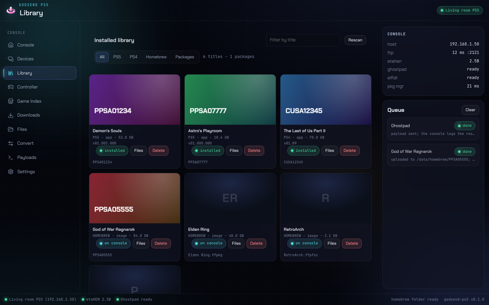

# GODsend PS5

[](https://ghostyshell.github.io/godsend-ps5/)
[](https://discord.gg/d3sFnrgpJn)
[](https://ko-fi.com/ghosty99)
[](https://etherscan.io/address/0xbBef115aD853236a350EaF04777a2AdB2e7c0317)

A desktop workshop for a jailbroken PlayStation 5. It connects over FTP, reads
the installed library, sends payloads to elfldr, drives the console with a
virtual controller, downloads games and homebrew to your Mac or PC, converts
what needs converting, and installs content back onto the console.

GODsend PS5 shares the GODsend family's "midnight console" design and the
Rust + Tauri stack of [GODsend PSP](https://github.com/ghostyshell/godsend-psp).



## Download

<!-- downloads:start -->
| Build | GoFile (primary) | file.kiwi (backup) | Size |
| --- | --- | --- | --- |
| `godsend-ps5-0.1.0-linux-x64.AppImage` | [Download](https://gofile.io/d/ynq1vPGb) | [Mirror](https://file.kiwi/21f44106#N8RuNbjqAr7M0jsIoT52Ag) | 80.3 MiB |
| `godsend-ps5-cli-0.1.0-linux-x64.tar.gz` | [Download](https://gofile.io/d/Ntlz1iJJ) | [Mirror](https://file.kiwi/8c2ee23c#bz-oXrjVV9JrQ7r239T1Vg) | 2.1 MiB |
| `godsend-ps5-cli-0.1.0-macos-arm64.tar.gz` | [Download](https://gofile.io/d/RlzF3M4Y) | [Mirror](https://file.kiwi/81f34716#BZsFjv_cV55N5ggljqREfw) | 1.9 MiB |
| `godsend-ps5-cli-0.1.0-macos-x64.tar.gz` | [Download](https://gofile.io/d/CTEyh203) | [Mirror](https://file.kiwi/fc7210a1#huxeErovQDZ8sYwa0W00Qg) | 2.0 MiB |
| `godsend-ps5-cli-0.1.0-windows-x64.zip` | [Download](https://gofile.io/d/15CTnSGO) | [Mirror](https://file.kiwi/523cebb5#19vWks9-YMmnsDwMpIDNGA) | 2.1 MiB |
| `godsend-ps5-0.1.0-linux-x64.deb` | [Download](https://gofile.io/d/agItpMAe) | [Mirror](https://file.kiwi/e9dd2309#yXduT7KQ7tfo902Tp9MS_w) | 5.5 MiB |
| `godsend-ps5-0.1.0-arm64.dmg` | [Download](https://gofile.io/d/vKS7veXr) | [Mirror](https://file.kiwi/e21d15b1#QTlXaJ3jCXQdwgKI2HOOIg) | 5.5 MiB |
| `godsend-ps5-0.1.0-x64.dmg` | [Download](https://gofile.io/d/QZA5a9Z2) | [Mirror](https://file.kiwi/c9ddc090#1HgjwwvbJS5O5vkFehj_eA) | 6.0 MiB |
| `godsend-ps5-0.1.0-x64-setup.exe` | [Download](https://gofile.io/d/ios6vOzC) | [Mirror](https://file.kiwi/efd94b5b#U2p3e9SyQIg8jG1MN2nbjg) | 3.7 MiB |
<!-- downloads:end -->

GoFile is the primary host and file.kiwi is the encrypted backup, the same
mirror pair as GODsend PSP and GODsend 360. Desktop builds are not notarized:
on first launch, right click the app, choose Open, then Open again, or run
`xattr -dr com.apple.quarantine "/Applications/GODsend PS5.app"`.

Every build on a `v*` tag is produced by CI for macOS (Apple Silicon and
Intel), Linux and Windows.

## What it does

**Console management**
- Add several PS5s, probe FTP and etaHEN, pick the active one.
- FTP fallback: the configured port, then 2121 (ftpsrv), 1337 (etaHEN) and 21.
- Reports the port that answered, the etaHEN version, whether the homebrew
  folder is reachable, and whether Ghostpad, elfldr and PKG Manager are up.
- LAN discovery: scans 2121 and 1337 across the subnet and keeps hosts that
  accept an FTP login.

**Library**
- Scans `/user/app` with metadata from `/user/appmeta`, `/data/homebrew` and
  `/data/etaHEN/games`, plus `/mnt/usb*/homebrew` and `/mnt/ext*/homebrew`.
- Reads PARAM.SFO over FTP for titles, title ids and versions; fetches and
  caches the app icon.
- Lists game images (`.exfat`, `.ffpkg`, `.ffpfs`, `.ffpfsc`) and folder dumps.
- Lists packages waiting in the PS5Upload package folder.
- Deletes a title, image or package when you confirm.

**Virtual controller**
- On-screen DualSense over the Ghostpad payload (TCP 6967, `GPAD` frames at
  60 Hz): d-pad, face buttons, shoulders, triggers, sticks, Create, Options,
  PS and touchpad.
- Press and hold works while the pointer is down.
- Keyboard mapping, combos and text macros.

**Payloads and homebrew**
- The payload catalogue is fetched at runtime from the public
  `itsPLK/ps5-payloads-mirror` list, so new builds appear without an app
  release.
- ELF and BIN payloads go straight to elfldr on 9021, including local files.
- Packages from the catalogue go to the package folder instead.

**Downloads**
- Game index search (the GameSearch debrid service) and Internet Archive
  search, with the files listed before you pick one.
- Downloads use aria2c with 16 connections when installed, plain HTTP
  otherwise. Jobs show progress and can be cancelled.

**Installs**
- PKG to the package queue (`/data/ps5upload/pkg_library` by default), where
  PS5Upload or the etaHEN PKG Manager installs it.
- Images to `/data/homebrew/<title id>/`, which ShadowMount+ mounts within 15
  seconds.
- Folder dumps to the same place.
- ELF to elfldr.
- ZIPs are unpacked first.
- FAT32 splitting when the destination is a USB drive.

**Conversions**
- Folder to ISO: ISO9660 plus Joliet, multi-extent files over 4 GiB.
- ISO to folder.
- ZIP pack and unpack.
- Split for FAT32 and merge a split set back.
- Inspect: format, system, title id, package type and split parts.

**Files**
- Two-pane local and console browser: upload, download, create folders,
  delete, with progress in the job queue.

## Requirements

- macOS 12+, Windows 10+ or a Linux desktop with WebKitGTK.
- A jailbroken PS5 with an FTP server: ftpsrv (2121) or etaHEN (1337).
- elfldr on 9021 for payload sending.
- Ghostpad on 6967 for the virtual controller.
- ShadowMount+ for mounting images dropped into the homebrew folder.
- Optional: `aria2c` on PATH for multi-connection downloads.
- Optional: Real-Debrid and/or TorBox keys for debrid links.
- Optional: a reachable GameSearch backend for download link resolution.
  The public site hides links behind sign-in, so browsing works but resolving
  needs the Go service. Internet Archive downloads need neither.

## Build

```sh
cargo test --workspace
npm --prefix app install
npm --prefix app run build
npm --prefix app run tauri build
```

Release artifacts for this machine, without CI or Finder automation:

```sh
scripts/build-local.sh                    # tests, app, DMG, CLI -> dist/local
scripts/publish-release.sh --artifacts dist
```

The CLI is `cargo build --release -p godsend-ps5-cli`; the binary is
`godsend-ps5`. Run it with no arguments for the command list.

## Configuration

Settings are stored as JSON in the platform data directory
(`~/Library/Application Support/godsend-ps5` on macOS,
`%APPDATA%\godsendps5\godsend-ps5` on Windows). The same folder holds the job
journal, cached icons and the cached payload catalogue.

FTP on a PS5 is plaintext and usually accepts `anonymous` with no password.
Keep the console on your own network.

## What it deliberately does not do

- **Install a fake package over the wire.** PS5Upload does that over its own
  encrypted helper protocol (AVA1, port 9120). GODsend leaves the package in
  the folder the installer watches and says so; it never claims an install
  that did not happen.
- **Build ShadowMount+ images.** `.ffpkg`, `.ffpfs` and `.ffpfsc` need the
  console-side Workshop tooling. This app inspects and transfers them.
- **Launch a game.** There is no stable HTTP or FTP launch endpoint on a PS5;
  launching needs a payload that owns the app registry.
- **Decrypt or repack packages.** That needs console keys the app does not
  ship.
- **Save data management, cheats, Remote Play streaming and a built-in MCP
  server.** These exist in the wider scene but are out of scope for this app
  today.

## Notes that matter

- PS5 fake packages install but do not launch above firmware 11.60. PS4 fake
  packages remain usable. The app reports what it can see, not what a file is
  supposed to do.
- The virtual pad is one device at a time, bound to the foreground user by the
  payload. Rumble, haptics, gyro and touchpad coordinates are not sent.

## Tests

- `cargo test --workspace`: parsers, PKG headers, SFO, ISO build/extract, ZIP
  round trip, split and merge, Ghostpad frame layout, and an end-to-end test
  against a fake FTP server, fake Ghostpad, fake elfldr and a fake PKG Manager.
- `npm --prefix app run test:ui`: Playwright against the mock bridge
  (`/?mock=1`), covering every page.

## Links

- Website and screenshots: https://ghostyshell.github.io/godsend-ps5/
- Changelog: [CHANGELOG.md](CHANGELOG.md)
- Discord: https://discord.gg/d3sFnrgpJn
- Ko-fi: https://ko-fi.com/ghosty99
- ETH: `0xbBef115aD853236a350EaF04777a2AdB2e7c0317`

## Layout

```
core/   Rust engine: FTP, library, payloads, Ghostpad, install, conversions
cli/    headless CLI
app/    Tauri 2 shell
  src/  React + TypeScript UI, styles.css, mock.ts
```

MIT licensed.
